<div align="center">



# 🚀 Awesome Terminal Emulators

### *A Curated List of Best Terminal Emulators, GPU-Accelerated Consoles, AI-Powered CLIs, and Remote SSH Clients*

<p align="center">
  <a href="https://github.com/ishandutta2007/Awesome-Awesome-Awesome"></a><a href="https://discord.gg/jc4xtF58Ve"></a>
  <a href="https://github.com/ishandutta2007/Awesome-Terminal-Emulators/stargazers"></a>
  <a href="https://github.com/ishandutta2007/Awesome-Terminal-Emulators/network/members"></a>
  <a href="https://github.com/ishandutta2007/Awesome-Terminal-Emulators/blob/main/LICENSE"></a>
  <a href="https://github.com/ishandutta2007/Awesome-Terminal-Emulators/pulls"></a>
  <a href="https://github.com/ishandutta2007"></a>
</p>

**Welcome to the definitive index of modern terminal emulators!**  
Whether you're looking for ultra-low latency GPU rendering, deep multiplexing and tiling, AI-assisted shell agents, cross-platform consistency across Linux, macOS, and Windows, or legacy serial/SSH protocol suites, this guide organizes the landscape with verified pricing, free tier constraints, and live GitHub community metrics.

</div>

---

## 📑 Table of Contents

- [🔍 SEO & Selection Taxonomy](#-seo--selection-taxonomy)
- [📊 Sector Overview & Market Dynamics](#-sector-overview--market-dynamics)
- [💼 Commercial & SaaS Terminal Platforms](#-commercial--saas-terminal-platforms)
- [⭐ Open-Source GitHub Projects (Ranked by Stars)](#-open-source-github-projects-ranked-by-stars)
- [🛠️ Feature Comparison Matrix](#️-feature-comparison-matrix)
- [🤝 How to Contribute](#-how-to-contribute)
- [💖 Support & Community](#-support--community)
- [⭐ Star History](#-star-history)
- [⚖️ Disclaimer & License](#️-disclaimer--license)

---

## 🔍 SEO & Selection Taxonomy

Target keywords: `terminal emulator`, `best terminal emulator 2026`, `GPU accelerated terminal`, `Rust terminal emulator`, `Windows Terminal`, `WezTerm`, `Ghostty`, `Alacritty`, `Kitty`, `Warp terminal`, `iTerm2 alternative`, `cross platform CLI`, `SSH client terminal`, `Sixel graphics terminal`.

When evaluating modern terminal emulators, power users prioritize five core architectural vectors:
1. **Rendering Engine**: Hardware-accelerated OpenGL, Metal, DirectX, or Vulkan rendering vs CPU rasterization for high refresh-rate displays.
2. **Multiplexing & Tiling**: Built-in tab and split-pane managers vs dependency on external multiplexers like `tmux` or `zellij`.
3. **Advanced Protocol Support**: TrueColor (24-bit RGB), font ligatures, Unicode 15/Emoji sequences, Kitty graphics protocol, iTerm2 inline images, and Sixel graphics.
4. **Configuration & Scriptability**: Fast declarative formats (TOML, YAML, JSON) or full embedded programming runtimes (Lua, Lisp, JavaScript).
5. **AI & Cloud Integration**: Local offline speed vs agentic prompt suggestion, shared cloud runbooks, and team secret managers.

---

## 📊 Sector Overview & Market Dynamics

- **Market Size & Valuation**: The terminal emulator, command-line interface (CLI) tooling, and remote terminal management market is estimated at **$3.5 Billion in 2026** (forming an integral segment of the broader $28 Billion developer operations and remote infrastructure tooling industry). Growth is catalyzed by cloud-native Kubernetes infrastructure, multi-cloud fleet management, and the rapid rise of AI-augmented command-line agents.
- **Market Dynamics & Fragmentation**: The market exhibits **moderate-to-high fragmentation** rather than a winner-take-all monopoly. Because underlying terminal transmission standards (ANSI escape codes, VT100/VT220 emulation, SSH, and terminfo) are open and universal, user switching costs remain low. The ecosystem is distinctly bifurcated:
  - **Local Workstation Segment**: Dominated by high-performance, non-profit, open-source engines (e.g., Windows Terminal, Ghostty, Alacritty, Kitty, WezTerm) competing on latency, font rendering, and memory footprint.
  - **Commercial & SaaS Segment**: Players differentiate through proprietary network synchronization, zero-trust cloud credential management, cross-device session persistence, and centralized AI agent orchestration (e.g., Warp, Termius, SecureCRT).

---

## 💼 Commercial & SaaS Terminal Platforms

The table below catalogs premier commercial and hosted terminal tools, complete with exact starting tier pricing, specific free tier / trial limitations, and estimated company scale.

> *Sorted descending by Company Scale (Valuation / Estimated Revenue).*

| Platform / Tool | Provider / Company | Company Size / Valuation / Revenue | Starting Paid Tier Pricing | Free Tier / Trial Limits | Key Capabilities & Target Environment |
|:---|:---|:---|:---|:---|:---|
| **[Warp](https://www.warp.dev/)** | Warp Services, Inc. | **$500M+ Valuation** ($73M Series B funded by Sequoia Capital & GV) | **$18/user/month** (or $15/user/month billed annually at $180/yr) for Build plan | **Free Forever**: Free individual tier includes 40 AI prompt credits/mo, 10 agent workflow runs/mo, local terminal history, and community support | Modern AI-native terminal emulator with agentic command execution, shared team drive, natural-language lookup, and MCP client support (macOS, Linux; Windows preview). |
| **[Termius](https://termius.com/)** | Termius Inc. | **$100M+ Valuation** (~$15M ARR, 5M+ active engineers) | **$12/user/month** (or $10/user/month billed annually at $120/yr) for Pro plan | **Free Forever**: Starter tier strictly limited to 1 local device sync, standard SSH/SFTP, port forwarding, basic terminal (no cross-device cloud sync or team vaults) | Cross-device synchronized SSH client, SFTP file manager, team credential vaults, mobile & desktop terminal emulation (iOS, Android, macOS, Windows, Linux). |
| **[SecureCRT](https://www.vandyke.com/products/securecrt/)** | VanDyke Software, Inc. | **~$15M Annual Revenue** (Bootstrapped enterprise stalwart founded in 1995) | **$149.00 one-time** per license (includes 1 full year of software updates & priority technical support) | **30-Day Free Trial**: 30 days of unrestricted, fully functional evaluation with all protocols enabled (SSH2, Telnet, Serial, Rlogin); no free forever tier | Enterprise-grade rock-solid session management, multi-session tabbed SSH, VBScript/Python automation for network engineers & sysadmins (Windows, macOS, Linux). |
| **[MobaXterm](https://mobaxterm.mobatek.net/)** | Mobatek | **~$8M Annual Revenue** (Profitable European remote infrastructure developer) | **$69.00 one-time** per user for Professional Edition (perpetual license with 12 months maintenance) | **Free Forever**: Home Edition strictly limited to maximum 12 simultaneous sessions, 2 SSH tunnels, 4 active macros, and TFTP file transfer timeouts of 360s | Enhanced Windows terminal with integrated X11 server, tabbed SSH, SFTP browser, VNC/RDP, Unix command toolchain on Windows. |
| **[Royal TS](https://www.royalapps.com/ts/win/features)** | Royal Applications GmbH | **~$5M Annual Revenue** (Established European remote administration tooling firm) | **€49.00 (~$53 USD) one-time** per user license (includes 1 year software maintenance) | **Free Forever**: Lite/Shareware edition capped at maximum 10 connections, 10 credentials, and 1 active document file | Comprehensive remote desktop, SSH, Telnet, PowerShell, and multi-protocol terminal management console for systems administrators. |
| **[ZOC Terminal](https://www.emtec.com/zoc/)** | EmTec Innovative Software | **~$3M Annual Revenue** (Specialized emulation firm founded in 1995) | **$89.99 one-time** per single user license (perpetual with minor version upgrades) | **30-Day Free Trial**: 30 days of unrestricted access to all VT220, Wyse, TN3270, and SSH sessions; no free forever tier | Professional emulation suite with deep support for legacy mainframes, modern SSH/Telnet, scripting engine (REXX), and serial communications. |

---

## ⭐ Open-Source GitHub Projects (Ranked by Stars)

The open-source terminal emulator ecosystem powers the world's developer workstations. Below are top repositories, decorated with live social star badges linking directly to their GitHub stargazers page.

> *Sorted descending by GitHub Star Count.*

| Rank | Terminal Emulator | GitHub Live Star Count | Primary Language | Rendering & Platform Focus |
|:---:|:---|:---:|:---:|:---|
| 1 | **[Windows Terminal](https://github.com/microsoft/terminal)** | [](https://github.com/microsoft/terminal/stargazers) | C++ / C# | DirectX hardware accelerated, tabs, panes, profiles, Windows 10/11 |
| 2 | **[Tabby](https://github.com/Eugeny/tabby)** | [](https://github.com/Eugeny/tabby/stargazers) | TypeScript | Electron-based, integrated SSH/Serial, customizable CSS, Cross-Platform |
| 3 | **[Alacritty](https://github.com/alacritty/alacritty)** | [](https://github.com/alacritty/alacritty/stargazers) | Rust | OpenGL GPU renderer, minimal bloat, simplicity & extreme speed, Cross-Platform |
| 4 | **[Ghostty](https://github.com/ghostty-org/ghostty)** | [](https://github.com/ghostty-org/ghostty/stargazers) | Zig / C | Metal & OpenGL/Vulkan, native macOS/Linux GUI, rich typography & speed |
| 5 | **[Hyper](https://github.com/vercel/hyper)** | [](https://github.com/vercel/hyper/stargazers) | JavaScript | Web technologies (HTML/CSS/JS), extensible plugin ecosystem, Cross-Platform |
| 6 | **[Kitty](https://github.com/kovidgoyal/kitty)** | [](https://github.com/kovidgoyal/kitty/stargazers) | Python / C | OpenGL GPU-based, Kittens plugin architecture, tiling window layouts, Linux/macOS |
| 7 | **[WezTerm](https://github.com/wezterm/wezterm)** | [](https://github.com/wezterm/wezterm/stargazers) | Rust | GPU-accelerated, built-in multiplexer, Lua config with hot-reload, Cross-Platform |
| 8 | **[Cmder](https://github.com/cmderdev/cmder)** | [](https://github.com/cmderdev/cmder/stargazers) | C++ / Shell | Portable console package for Windows bundling ConEmu, Clink, and Git Bash |
| 9 | **[Cool Retro Term](https://github.com/Swordfish90/cool-retro-term)** | [](https://github.com/Swordfish90/cool-retro-term/stargazers) | QML / C++ | Nostalgic cathode-ray tube (CRT) display simulator with scanlines, Cross-Platform |
| 10 | **[Wave Terminal](https://github.com/wavetermdev/waveterm)** | [](https://github.com/wavetermdev/waveterm/stargazers) | TypeScript / Go | Open-source, AI-integrated workspace terminal with graphical rendering cards |
| 11 | **[iTerm2](https://github.com/gnachman/iTerm2)** | [](https://github.com/gnachman/iTerm2/stargazers) | Objective-C | macOS de-facto standard, inline images, instant replay, shell integration |
| 12 | **[Fluent Terminal](https://github.com/felixse/FluentTerminal)** | [](https://github.com/felixse/FluentTerminal/stargazers) | TypeScript / C# | UWP & web technology terminal emulator with Windows Fluent Design aesthetics |
| 13 | **[ConEmu](https://github.com/ConEmu/ConEmu)** | [](https://github.com/ConEmu/ConEmu/stargazers) | C++ | Deeply customizable Windows tabbed console engine, splits, quake-mode |
| 14 | **[Rio](https://github.com/raphamorim/rio)** | [](https://github.com/raphamorim/rio/stargazers) | Rust | Hardware-accelerated GPU terminal built on WebGPU/wgpu, Cross-Platform |
| 15 | **[Contour](https://github.com/contour-terminal/contour)** | [](https://github.com/contour-terminal/contour/stargazers) | C++ | Modern terminal with VT525 emulation, Sixel/iTerm graphic protocols, Qt/OpenGL |
| 16 | **[Extraterm](https://github.com/sedwards2009/extraterm)** | [](https://github.com/sedwards2009/extraterm/stargazers) | TypeScript / C++ | "Swiss army chainsaw" terminal with command framing, shell integration & mini-map |

---

### 🌟 Project Deep Dives

#### 1. [Windows Terminal](https://github.com/microsoft/terminal) [](https://github.com/microsoft/terminal/stargazers)
- **Overview**: Microsoft's official flagship terminal host for Windows 10 & 11, replacing `conhost.exe`.
- **Highlights**: DirectX hardware-accelerated text rendering, tabs, split panes, UTF-8/emoji glyph support, custom shaders, and native profile management for PowerShell, WSL2, Git Bash, and CMD.
- **License**: MIT.

#### 2. [Tabby](https://github.com/Eugeny/tabby) [](https://github.com/Eugeny/tabby/stargazers)
- **Overview**: The most complete cross-platform terminal with integrated SSH and serial connections.
- **Highlights**: Embedded SSH client with connection organizer, SFTP/Zmodem file transfers, port forwarding, theme customization via CSS, and full session persistence.
- **License**: MIT.

#### 3. [Alacritty](https://github.com/alacritty/alacritty) [](https://github.com/alacritty/alacritty/stargazers)
- **Overview**: The pioneer of Rust-based, GPU-accelerated terminal emulation prioritizing raw speed.
- **Highlights**: Zero UI bloat, OpenGL rendering, portable configuration via TOML, designed specifically to pair cleanly with multiplexers like `tmux` or `zellij`.
- **License**: Apache-2.0.

#### 4. [Ghostty](https://github.com/ghostty-org/ghostty) [](https://github.com/ghostty-org/ghostty/stargazers)
- **Overview**: Fast, feature-rich, native terminal emulator created by Mitchell Hashimoto, written in Zig.
- **Highlights**: Native platform UI (Swift/Metal on macOS, GTK on Linux), native tabs/splits, ligature rendering, Kitty graphics protocol, high-frequency input dispatch.
- **License**: MIT.

#### 5. [Hyper](https://github.com/vercel/hyper) [](https://github.com/vercel/hyper/stargazers)
- **Overview**: Electron-based terminal created by Vercel built on web standards (HTML, CSS, JavaScript).
- **Highlights**: Infinite front-end extensibility via npm packages, active theme marketplace, hotkey-driven pane splitting, and instant customizability.
- **License**: MIT.

#### 6. [Kitty](https://github.com/kovidgoyal/kitty) [](https://github.com/kovidgoyal/kitty/stargazers)
- **Overview**: GPU-accelerated terminal for macOS and Linux created by Kovid Goyal.
- **Highlights**: Offloads rendering to OpenGL, built-in window tiling layouts, "Kittens" extensibility framework (side-by-side diffing, Unicode picker, hints), and pioneering terminal graphics protocol.
- **License**: GPL-3.0.

#### 7. [WezTerm](https://github.com/wezterm/wezterm) [](https://github.com/wezterm/wezterm/stargazers)
- **Overview**: The most complete modern cross-platform terminal emulator and multiplexer written in Rust.
- **Highlights**: Embedded terminal multiplexer (no `tmux` required for splits/tabs/workspaces), Lua scripting with hot reloading, Sixel/iTerm/Kitty graphics protocol, ligatures, and TrueColor.
- **License**: MIT.

#### 8. [Cmder](https://github.com/cmderdev/cmder) [](https://github.com/cmderdev/cmder/stargazers)
- **Overview**: Beloved portable console emulator package for Windows.
- **Highlights**: Bundles ConEmu with Clink enhancements, Monokai color scheme, custom prompt, and Git for Windows out-of-the-box.
- **License**: MIT.

#### 9. [Cool Retro Term](https://github.com/Swordfish90/cool-retro-term) [](https://github.com/Swordfish90/cool-retro-term/stargazers)
- **Overview**: A terminal emulator which mimics the look and feel of old cathode ray tube (CRT) screens.
- **Highlights**: Customizable vintage phosphor glows (amber, green, apple II), scanlines, curvature, bloom, and noise simulation powered by QtQuick/QML.
- **License**: GPL-3.0.

#### 10. [Wave Terminal](https://github.com/wavetermdev/waveterm) [](https://github.com/wavetermdev/waveterm/stargazers)
- **Overview**: Next-generation open-source AI terminal that merges CLI execution with graphical preview cards.
- **Highlights**: Seamless inline markdown, images, web pages, and file previews directly inside your terminal session, alongside context-aware AI chat.
- **License**: Apache-2.0.

#### 11. [iTerm2](https://github.com/gnachman/iTerm2) [](https://github.com/gnachman/iTerm2/stargazers)
- **Overview**: The standard macOS terminal replacement by George Nachman.
- **Highlights**: Split panes, hotkey windows (quake style), instant replay DVR mode, shell integration, inline image rendering, Python API, and password manager integration.
- **License**: GPL-2.0.

#### 12. [Fluent Terminal](https://github.com/felixse/FluentTerminal) [](https://github.com/felixse/FluentTerminal/stargazers)
- **Overview**: UWP-based terminal emulator with modern Windows Acrylic and Reveal effects.
- **Highlights**: Custom keybindings, search, multiple shell tabs, and theme import/export.
- **License**: Apache-2.0.

#### 13. [ConEmu](https://github.com/ConEmu/ConEmu) [](https://github.com/ConEmu/ConEmu/stargazers)
- **Overview**: Veteran Windows console emulator hosting multiple command-line applications in a tabbed window.
- **Highlights**: Split panes, ANSI X3.64 and xterm 256 colors, quake-style slide-down animations, and Far Manager integration.
- **License**: BSD-3-Clause.

#### 14. [Rio](https://github.com/raphamorim/rio) [](https://github.com/raphamorim/rio/stargazers)
- **Overview**: High-performance hardware-accelerated terminal emulator built with Rust and WebGPU.
- **Highlights**: Leverages the `wgpu` ecosystem for consistent cross-platform graphics, minimal resource usage, split screens, and font ligatures.
- **License**: Apache-2.0.

#### 15. [Contour](https://github.com/contour-terminal/contour) [](https://github.com/contour-terminal/contour/stargazers)
- **Overview**: Cutting-edge C++ terminal emulator with strict VT standard compliance.
- **Highlights**: Full Sixel and modern graphics protocol support, clickable hyperlinks, modal vi-mode copy/paste, and GPU rendering via OpenGL.
- **License**: Apache-2.0.

#### 16. [Extraterm](https://github.com/sedwards2009/extraterm) [](https://github.com/sedwards2009/extraterm/stargazers)
- **Overview**: A terminal designed to expand the concept of the CLI with structural GUI elements.
- **Highlights**: Command "framing" to reuse past stdout as input pipes, scrollback mini-map, inline image preview, and command palette.
- **License**: MIT.

---

## 🛠️ Feature Comparison Matrix

| Terminal | GPU Acceleration | Built-in Multiplexing | Config Language | Linux | macOS | Windows | Primary Strength |
|:---|:---:|:---:|:---:|:---:|:---:|:---:|:---|
| **Windows Terminal** | DirectX | ✅ Tabs & Panes | JSON | ❌ | ❌ | ✅ | Native Windows OS integration |
| **Tabby** | WebGL | ✅ Tabs & Panes | YAML | ✅ | ✅ | ✅ | Integrated SSH & SFTP manager |
| **Alacritty** | OpenGL | ❌ (Pair with tmux) | TOML | ✅ | ✅ | ✅ | Ultra-low latency & minimalism |
| **Ghostty** | Metal / OpenGL | ✅ Tabs & Splits | Key-Value | ✅ | ✅ | ⚠️ | Modern native UI, Zig speed & fidelity |
| **Kitty** | OpenGL | ✅ Window Tiling | Custom | ✅ | ✅ | ❌ | Kittens ecosystem & fast graphics |
| **WezTerm** | OpenGL / Vulkan | ✅ Tabs, Panes, Workspaces | Lua | ✅ | ✅ | ✅ | Built-in multiplexer & hot-reload Lua |
| **Warp** | Metal / DirectX | ✅ Blocks & Panes | GUI / Cloud | ✅ | ✅ | ⚠️ | AI agent command workflows |
| **iTerm2** | Metal | ✅ Tabs & Panes | GUI / Plist | ❌ | ✅ | ❌ | Polished macOS power-user tooling |

---

## 🤝 How to Contribute

Contributions are warmly encouraged! Help keep this directory current, accurate, and useful for the developer community:

1. **Fork the Repository**: Click the Fork button at the top right of this page.
2. **Clone & Branch**:
   ```bash
   git clone https://github.com/ishandutta2007/Awesome-Terminal-Emulators.git
   cd Awesome-Terminal-Emulators
   git checkout -b feature/add-new-terminal
   ```
3. **Add Entries**:
   - Follow the established markdown formatting.
   - For open-source projects, include the social style star badge linked to the stargazers page:
     `[](https://github.com/<owner>/<repo>/stargazers)`
   - For commercial/SaaS tools, provide specific starting tier prices and explicit free tier / trial terms.
4. **Submit a PR**: Open a descriptive Pull Request with links to official docs or project pages.

---

## 💖 Support & Community

Thank you for exploring **Awesome Terminal Emulators**! If this curated guide helped you discover your daily driver terminal or optimize your command-line workflow, please consider supporting the project:

- ⭐ **Star this repository** on GitHub to increase visibility for fellow developers.
- 🍴 **Fork and contribute** new terminal emulators, updates, benchmarks, and feature corrections.
- 📢 **Share this repository** on Twitter/X, Reddit, LinkedIn, Hacker News, and developer Discord servers.
- ☕ **Sponsor & Buy Me a Coffee**: If you'd like to support ongoing curation and maintenance, visit the [**GitHub Sponsors Dashboard**](https://github.com/sponsors/ishandutta2007).

<p align="center">
  <a href="https://github.com/sponsors/ishandutta2007">
    
  </a>
</p>

---

## ⭐ Star History

[](https://star-history.dera.page/#ishandutta2007/Awesome-Terminal-Emulators&type=date&legend=top-left)

---

## ⚖️ Disclaimer & License

- **Disclaimer**: This is a community-curated technical directory. Product trademarks and logos belong to their respective copyright holders. Pricing, license terms, and cloud limits are verified periodically but may change over time—always verify with vendor documentation.
- **License**: Released under the [MIT License](LICENSE).
